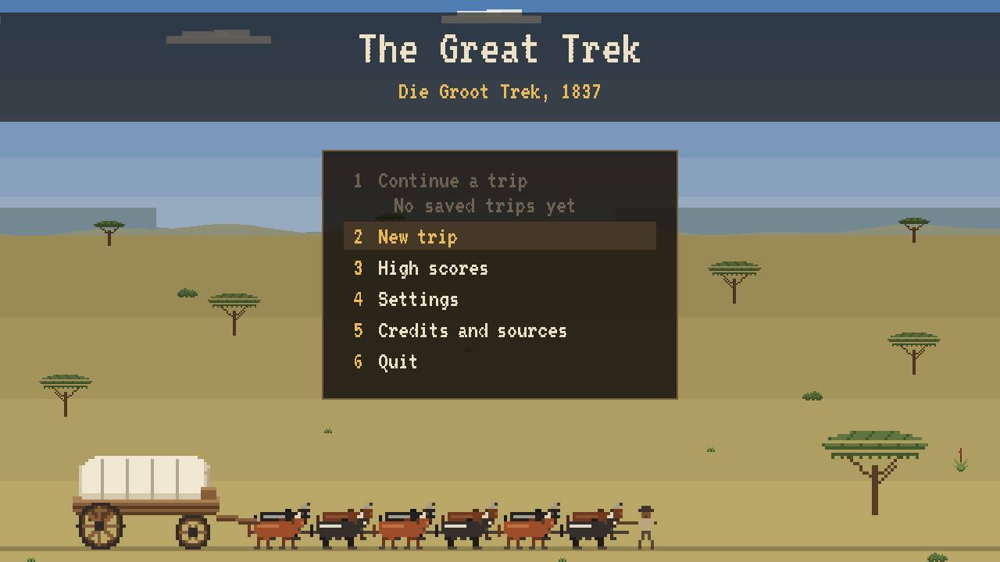
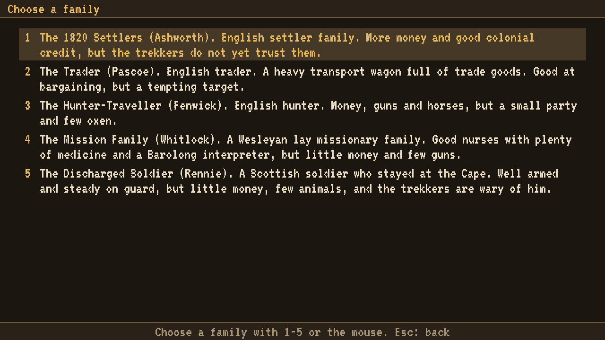
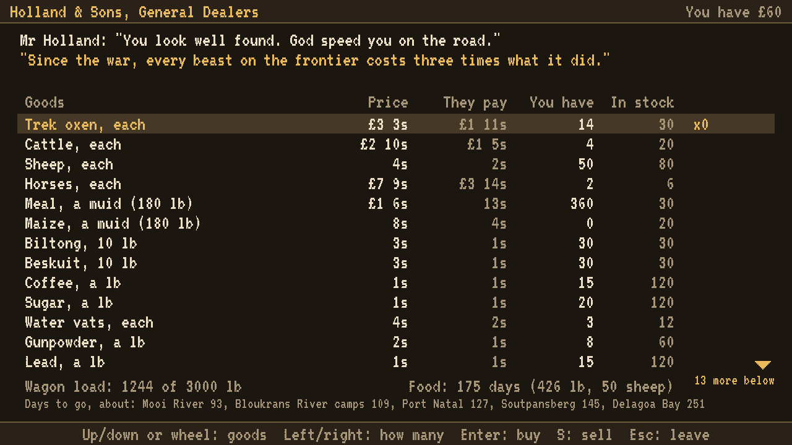
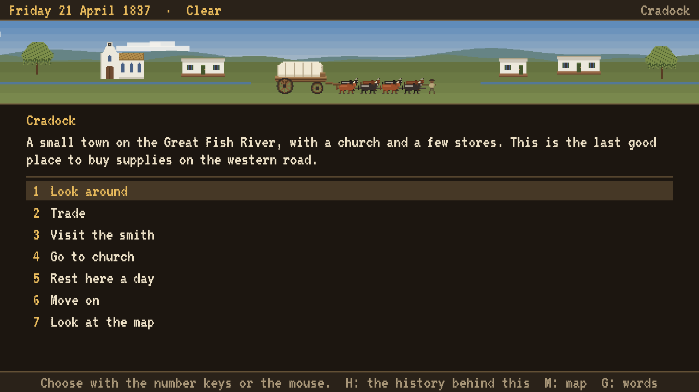
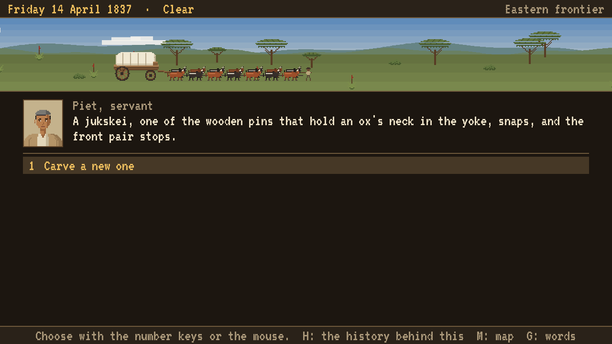
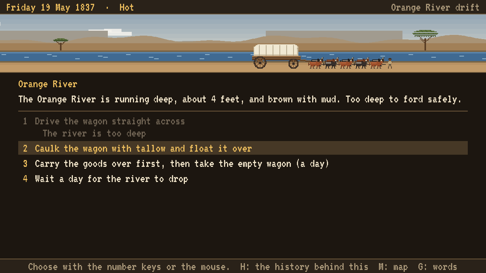
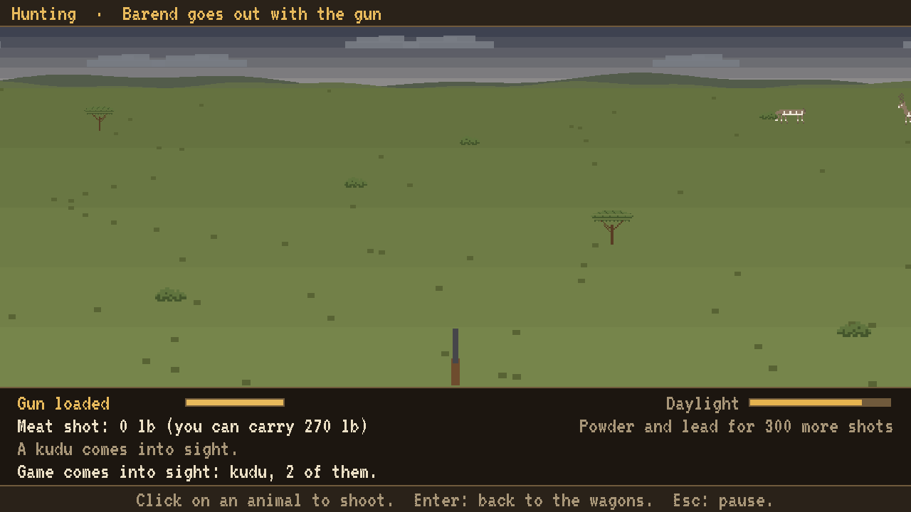
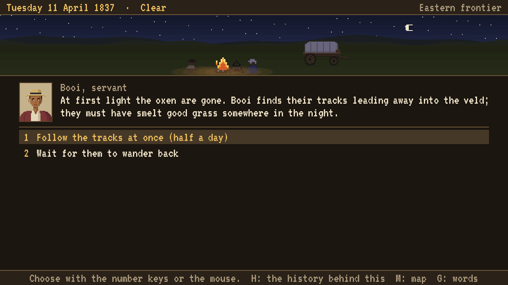
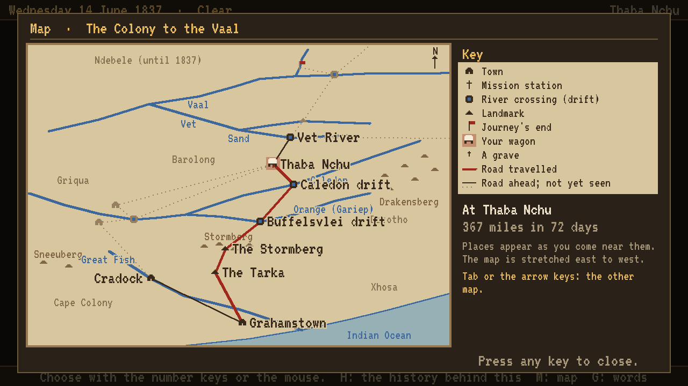

# The Great Trek / Die Groot Trek

A survival game in the spirit of *The Oregon Trail*, set on the Great Trek in South Africa in 1837. Choose to play a Dutch (Voortrekker) or English (settler/trader) family. Outfit your wagon in Grahamstown and lead your family north across the Orange and Vaal rivers to the Highveld.

Written in C with SDL3. Licensed under the GNU GPL v3 (see `LICENSE`).

**Status:** playable from start to finish, still being tested and balanced. See `docs/planning/` for the design and the historical research.



| | |
|---|---|
|  |  |
| Choose one of five families on each side, each with its own story. | Outfit the wagon in Grahamstown at 1837 prices. |
|  |  |
| Towns on the road: trade, mend the wagon, go to church. | On the road, the people in your party meet trouble and decide. |
|  |  |
| Cross the rivers: ford, float the wagon, or wait for the water to drop. | Hunt for meat on the veld. |
|  |  |
| Nights in camp, and losing the oxen. | The map of the road travelled, from the Colony to the Vaal. |

## Playing

Pick a side and one of ten fictional families, read how they came to be in Grahamstown, name your party, and set out in April 1837. On the road you choose the pace, the rations and how to keep watch at night; you buy supplies in the colonial towns, barter beyond the Orange River, hunt, cross rivers, and decide what to do when things go wrong. The trip saves itself after every step, and there is one save per trip, so what happens on the road stays happened.

| Key | What it does |
|---|---|
| 1-9 or the mouse | choose |
| Enter | confirm or continue |
| Esc | the menu (save and quit) |
| M / J / G | map / journal / glossary of period words |
| H | the history behind an event |
| P / S | party / supplies (in an event) |
| F11 | full screen |

### Trying the beta (Windows)

**Installer (recommended):**
1. Download `TheGreatTrek-<version>-windows-setup.exe` from the [Releases](https://github.com/josephcolton/TheGreatTrek/releases) page and run it.
2. The installer isn't signed, so Windows may say "Windows protected your PC". Choose **More info**, then **Run anyway**. Windows then asks whether to let an app from an unknown publisher make changes; choose **Yes**.
3. It installs into Program Files and adds the game to the Start menu (and the desktop, if you tick the box). Choose "Install for me only" if you don't have admin rights. Installing a newer version over the old one upgrades it. Uninstall from Windows Settings, Apps.

**Or the zip:** download `TheGreatTrek-<version>-windows.zip`, unzip it anywhere, keep the folder together, and run `TheGreatTrek.exe`. Nothing needs installing; Windows may show the same "protected your PC" warning.

Saves are kept in `%APPDATA%\TheGreatTrek\TheGreatTrek\trips`. Uninstalling the game or deleting its folder does not delete them.

If something goes wrong or reads oddly, please open an [issue](https://github.com/josephcolton/TheGreatTrek/issues) or tell the person who sent you the game. Say:
- what you were doing
- which family you were playing
- what you expected to happen

If you can, attach the trip's save file from the folder above.

Every event says where its history comes from; press H to read it. The families are invented; the places, prices and much of what happens are taken from period sources such as Captain Harris (1836-37) and James Backhouse (1838-39).

## Building

You need CMake 3.24 or newer, a C17 compiler (GCC, Clang or MSVC) and Ninja (or another CMake generator). SDL3, SDL3_ttf and SDL3_image are downloaded and built automatically.

```sh
cmake -S . -B build -G Ninja -DCMAKE_BUILD_TYPE=Release
cmake --build build
ctest --test-dir build
./build/bin/TheGreatTrek
```

Options: `-DTREK_USE_SYSTEM_SDL=ON` to use SDL3 packages already installed on your system; `-DTREK_BUILD_GAME=OFF` to build only the simulation core, tools and tests.

`tools/package.sh` builds a Release and packs a zip with the game, its data, the licence and the credits into `dist/`. On Windows, if [Inno Setup](https://jrsoftware.org/isinfo.php) 6 is installed (`winget install JRSoftware.InnoSetup`), it also builds the installer from `packaging/windows/TheGreatTrek.iss`.

The icon (an ox wagon on Karoo brown) is drawn by `tools/make_icon.py` into `assets/icon/`: `icon.ico` is built into the Windows exe and can be used by an installer, and `icon.png` is the window icon. On Linux, `packaging/linux/thegreattrek.desktop` is a desktop launcher: set `Exec=` to the full path of `TheGreatTrek`, copy it to `~/.local/share/applications/`, and copy `assets/icon/icon.png` to `~/.local/share/icons/hicolor/256x256/apps/thegreattrek.png`.

`tools/screenshots.sh build` retakes the screenshots above.

Tools: `datacheck` checks the data files and text, and `trekbot` plays hundreds of games to check balance (`trekbot --runs 200`).
